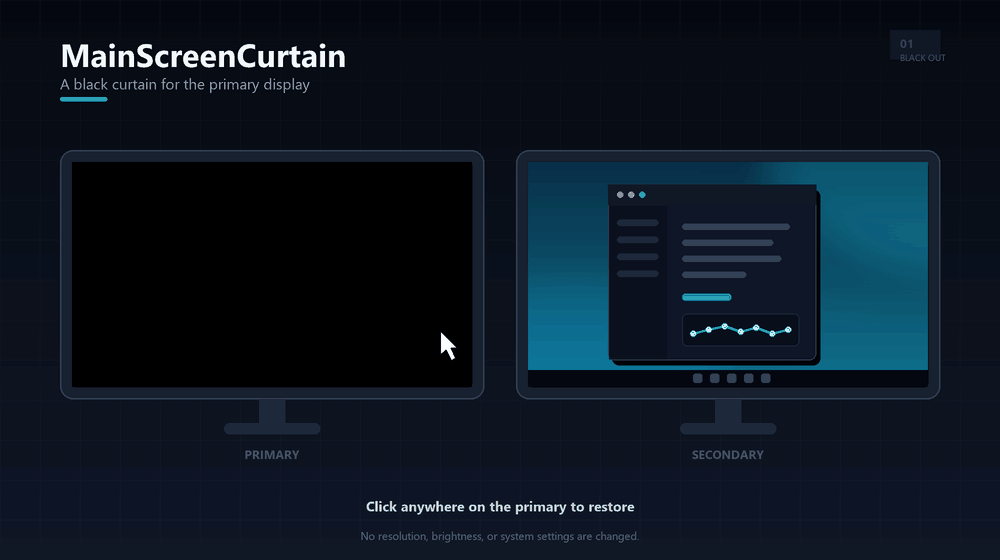

# MainScreenCurtain（主屏熄）

中文 · [English](README.md)


一个 Windows 小工具，在主屏上盖一层纯黑窗口，副屏照常使用。左键单击主屏，黑幕立刻消失。



## 它做什么

- 只盖住主显示器，画面为纯黑。
- 副屏不受影响，鼠标光标仍然可见。
- 左键单击主屏任意位置退出，桌面立即恢复。
- 启动后的 0.7 秒内忽略点击，避免双击启动时的第二下把窗口关掉。
- 主显示器发生变化，或者窗口被最小化时，程序自动退出。

程序不修改分辨率、亮度、显示模式、注册表或电源设置。结束进程，一切恢复原样。

## 运行要求

Windows 10 或 Windows 11。

预编译的 exe 依赖 .NET 10 Desktop Runtime。系统提示缺少运行时时，到 [dotnet.microsoft.com](https://dotnet.microsoft.com/download/dotnet/10.0) 下载安装。

从源码构建需要 .NET 10 SDK。

## 下载

到 [Releases](https://github.com/WXJB-D/MainScreenCurtain/releases/latest) 下载最新的 `MainScreenCurtain-vX.Y.Z-win-x64.zip`，解压后运行 `MainScreenCurtain.exe`。

exe 没有代码签名，首次运行可能被 Windows SmartScreen 拦截。确认来源可信后点“更多信息”，再点“仍要运行”，也可以自行构建。

## 使用

1. 双击 `MainScreenCurtain.exe`。
2. 主屏变黑，副屏继续正常工作，鼠标光标仍然可见。
3. 左键单击主屏任意位置，黑幕关闭。

启动后的 0.7 秒是保护期，防止启动时的第二下双击把窗口关掉。

不想让光标停在主屏时，把它移到副屏。白色光标长时间静止在 OLED 上也可能留下痕迹，只是比静态画面慢得多。

## 从源码构建

```bat
.\build.cmd
```

脚本会生成单文件、依赖本机运行时的 `publish\MainScreenCurtain.exe`。

也可以直接执行下面的命令。

```bat
dotnet publish MainScreenCurtain.csproj -c Release -r win-x64 --self-contained false -p:PublishSingleFile=true -o publish
```

## 注意

- Windows 通知默认出现在主屏右下角，可能短暂浮在黑幕之上。长时间使用建议开启专注助手。
- 主屏任务栏会被一起盖住，副屏的任务栏可以正常使用。
- 程序不会阻止 Windows 按电源计划关闭显示器。
- 主显示器切换时，例如 `Win+P` 选择“仅第二屏幕”，黑幕会自动退出，避免盖住副屏。
- 需要应急退出时，在任务管理器中结束 `MainScreenCurtain.exe`。按下 `Win+D` 最小化窗口时，程序也会自动退出。

## 许可证

MIT，见 [LICENSE](LICENSE)。
